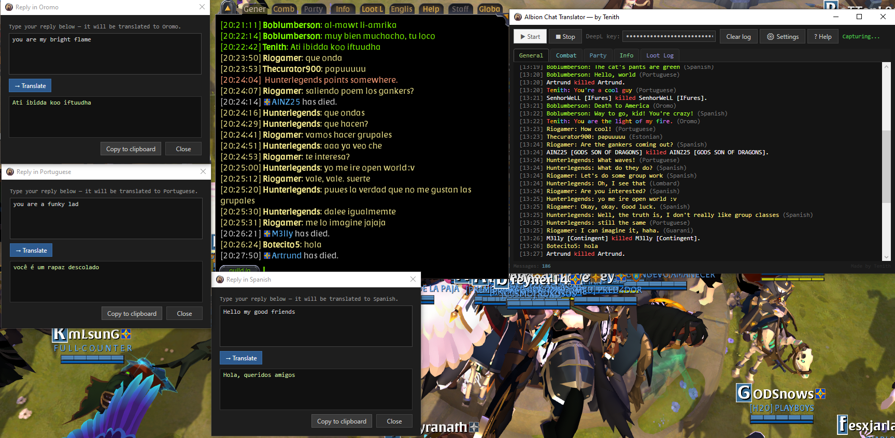

# Albion Chat Translator

Real-time chat translation for Albion Online, powered by DeepL.

Captures game chat directly from network packets and displays translated messages in a tabbed overlay — no game files touched, no injection.



---

## Features

- **Live translation** of all chat channels (Say, Whisper, Party, Guild, Alliance, and more)
- **Configurable target language** — translate to any of 30+ languages, not just English
- **Reply composer** — click the language tag on any translated message to open a reply window, type in your language, and get a translated response ready to paste
- **Albion-aware glossary** — city names, abbreviations (BW, FS, Thet, Brec…), dungeon types, and item links are never mangled by the translator
- **Per-tab controls** — enable or disable individual chat tabs from Settings
- **Smart auto-scroll** — stays at the bottom while you're reading, freezes when you scroll up
- Stays on top of the game window

---

## Requirements

- Windows 10/11 x64
- [.NET 9 Windows Desktop Runtime (x64)](https://builds.dotnet.microsoft.com/dotnet/WindowsDesktop/9.0.14/windowsdesktop-runtime-9.0.14-win-x64.exe)
- A free [DeepL API key](https://www.deepl.com/en/pro-api#api-pricing) (500,000 characters/month free — more than enough for chat)

---

## Installation

1. Download `AlbionChatTranslator_Setup.exe` from [Releases](../../releases)
2. Run the installer — it will prompt you to download the .NET runtime if needed
3. Launch **Albion Chat Translator** from the desktop shortcut (runs as Administrator automatically)

---

## Setup

1. Get a free DeepL API key — [sign up here](https://www.deepl.com/en/pro-api#api-pricing), then grab your key from [your account page](https://www.deepl.com/en/your-account/keys)
2. Paste the key into the key field and click **▶ Start**
3. Log in to Albion Online — your chat tabs will populate automatically
4. Use **⚙ Settings** to pick your target language and enable/disable tabs

---

## Why Administrator?

Raw packet capture on Windows requires elevated privileges. The installer sets this automatically via the Windows AppCompatFlags registry key — you won't need to right-click every time.

---

## Building from source

```
git clone <repo>
cd AlbionChatTranslator
dotnet publish AlbionChatTranslator/AlbionChatTranslator.csproj -c Release -r win-x64 --no-self-contained -o publish
```

To rebuild the installer, compile `installer.iss` with [Inno Setup 6](https://jrsoftware.org/isinfo.php).

---

## Credits

Made by **Tenith**
Packet capturing ripped from [Albion Statistics Analysis](https://github.com/Triky313/AlbionOnline-StatisticsAnalysis)

Much of this project was generated with AI (Claude Code)

Translation powered by [DeepL](https://www.deepl.com)
